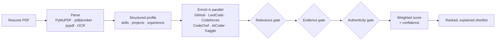
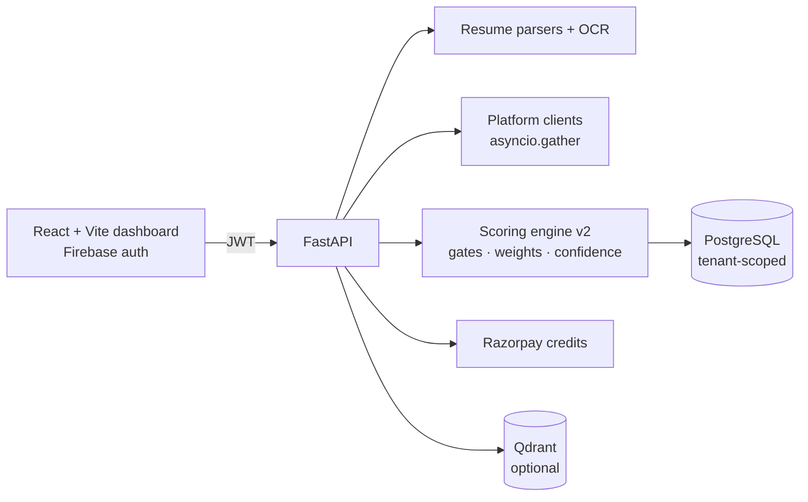

<div align="center">


# Kovidam Skill Graph

**Hire on engineering evidence, not keywords.**

Kovidam Skill Graph reads a stack of resumes, pulls each candidate's real work from GitHub and five coding platforms, and returns a ranked shortlist in which every score explains itself.

[](https://fastapi.tiangolo.com/)
[](https://vitejs.dev/)
[](https://github.com/pgvector/pgvector)
[](https://qdrant.tech/)
[](https://firebase.google.com/)
[](https://razorpay.com/)

[Live product](https://kovidam.co.in/) · [How it scores](#how-a-candidate-is-scored) · [Architecture](#architecture) · [Quick start](#quick-start) · [API](#api)

</div>

---

## Why it exists

An ATS matches the words on a resume. Anyone can write "Python, Docker, Kubernetes".
Kovidam asks a different question: **what has this person actually built, and how sure are we?**

- **Evidence over claims.** A skill counts for more when a repository, a contest rating or a project backs it up.
- **Explainable by default.** Each candidate comes back with the gates they passed, the signals behind the score and a confidence level, so a recruiter can defend every decision.
- **Built for real volume.** Resumes are parsed in batches, platforms are queried concurrently, and progress streams to the dashboard while the shortlist is built.

Kovidam Skill Graph is one of the two products behind [Kovidam](https://kovidam.co.in/). The other is [kovidam-AI-Interview](https://github.com/kartikeyajay2006/kovidam-AI-Interview).

## What it does

| | |
|---|---|
| **Batch resume parsing** | PDFs go through PyMuPDF, pdfplumber and pypdf, with Tesseract OCR for scanned files. Skills, projects, experience and profile links come out as structured JSON. |
| **Live signal enrichment** | GitHub, LeetCode, Codeforces, CodeChef, AtCoder and Kaggle are fetched **in parallel** for every candidate who lists a handle. |
| **GitHub depth analysis** | Seven analyzers read real repositories: architecture, API complexity, testing, infrastructure, ownership, consistency and an overall depth score. |
| **Three scoring gates** | Relevance, evidence and authenticity gates filter candidates before they are ranked (details below). |
| **Role-aware weights** | Separate weight profiles for **job** and **internship** hiring across eight dimensions, all tunable from `.env`. |
| **Semantic search** | Ask in plain English ("backend interns who have shipped FastAPI services") and Qdrant finds matching candidates. |
| **Recruiter dashboard** | Live shortlist progress, shortlist history, drill-down per candidate, export to Excel and an admin console. |
| **Multi-tenant and billed** | Each company sees only its own data. Shortlists draw from Razorpay-backed credits. |

## How a candidate is scored



1. **Relevance gate**: does the profile match the role's domain and the must-have skills? Skills are normalised through an alias and implication dictionary, so "Postgres" and "PostgreSQL" count as one skill.
2. **Evidence gate**: is each claimed skill backed by a repository, a project or platform activity?
3. **Authenticity gate**: the spam detector, timeline analyzer, repository-quality analyzer and contradiction detector flag padded or inconsistent profiles.
4. **Weighted score**: eight dimensions (skills, GitHub, experience, platforms, projects, profile, experience quality and achievements) are combined with the role's weight profile.
5. **Confidence**: an ambiguity detector and evidence-confidence model say how sure the system is, so a thin profile is never ranked as confidently as a well-evidenced one.

Thresholds such as `JOB_MIN_SKILL_MATCH_PCT` and `JOB_MIN_GITHUB_SCORE_100`, and every weight, live in `backend/.env`. You can retune the scoring without changing code.

## Architecture



## Tech stack

| Layer | Technology |
|---|---|
| Backend | Python, FastAPI, SQLAlchemy 2, Alembic, Pydantic Settings |
| Parsing | PyMuPDF, pdfplumber, pypdf, Tesseract OCR, BeautifulSoup, Playwright |
| AI | OpenAI API (experience and notes analysis), Qdrant vector search |
| Data | PostgreSQL (pgvector image), Qdrant |
| Frontend | React, Vite, Framer Motion, Firebase Auth, SheetJS (Excel export) |
| Payments | Razorpay |
| Tooling | Docker, pytest, ESLint |

## Quick start

**Prerequisites:** Docker, Python 3.11+, Node.js 20+.

```bash
git clone https://github.com/kartikeyajay2006/Kovidam-Skill-Graph.git
cd Kovidam-Skill-Graph

# 1. Configure the backend
cp backend/.env.example backend/.env      # add OPENAI_API_KEY, GITHUB_PAT, DATABASE_URL

# 2. Start PostgreSQL + Qdrant in Docker, run migrations, start the API on :8000
./scripts/dev_backend.sh

# 3. In a second terminal, start the dashboard on :5173
./scripts/dev_frontend.sh
```

Interactive API docs are served at `http://localhost:8000/docs`.

<details>
<summary><b>Key environment variables</b></summary>

| Variable | Purpose |
|---|---|
| `OPENAI_API_KEY` | Experience-quality and notes analysis |
| `GITHUB_PAT` | GitHub API token for repository analysis |
| `DATABASE_URL` | PostgreSQL connection string |
| `RESUME_CONCURRENCY`, `GITHUB_REPO_CONCURRENCY` | Parallelism for batch parsing and repository scans |
| `JOB_WEIGHT_*`, `INTERN_WEIGHT_*` | Per-dimension weights for job and internship scoring |
| `JOB_MIN_*` | Hard thresholds for the gates |
| `QDRANT_ENABLED`, `QDRANT_URL` | Turn the semantic search layer on or off |
| `ADMIN_EMAILS` | Accounts that can open the admin console |

</details>

## API

| Method | Endpoint | Purpose |
|---|---|---|
| `POST` | `/resume/extract` · `/resume/extract/batch` | Parse one or many resumes |
| `POST` | `/hiring/shortlist` | Score candidates against a role and build a shortlist |
| `GET` | `/hiring/shortlist/progress/{trace_id}` | Live progress while a shortlist builds |
| `GET` | `/hiring/shortlists` · `/hiring/shortlist/{trace_id}` | Shortlist history and detail |
| `POST` | `/hiring/semantic-search` | Natural-language candidate search |
| `GET` | `/hiring/dashboard-metrics` | Dashboard counters |
| `GET` `PUT` | `/account/profile` | Company profile |
| `POST` | `/api/create-order` · `/api/verify-payment` | Razorpay credit purchase |
| `GET` | `/admin/overview` · `/admin/companies` | Admin console |
| `POST` | `/chat/respond` | Product help chat |

## Project structure

```text
backend/
  app/
    main.py               FastAPI app and routes
    integrations/         GitHub, LeetCode, Codeforces, CodeChef, AtCoder, Kaggle, Qdrant
    scoring/
      gating/             relevance, evidence and authenticity gates
      authenticity/       spam, timeline, repo-quality and contradiction detectors
      github/depth_analysis/  seven repository analyzers
      confidence/         ambiguity and evidence-confidence models
      engine.py           scoring engine v2
    services/             resume parser, DB writer, notifier
    constants/            skill aliases, implications, roles and domains
  alembic/                database migrations
  tests/                  pytest suite
frontend/
  src/pages/              landing, dashboard, shortlist, semantic search, admin
scripts/                  one-command dev scripts for backend and frontend
```

## Tests

```bash
cd backend && pytest
```

The suite covers the v2 scoring engine, the shortlist policy, the resume parser, the semantic must-have checks, the Razorpay credit flow and the response schema.

## Author

Built by **[Kartikeya Yadav](https://github.com/kartikeyajay2006)**, co-founder and AI engineer at [Kovidam](https://kovidam.co.in/).
[LinkedIn](https://www.linkedin.com/in/kartikeya2006/) · [Portfolio](https://kartikeya-portfolio-rx7w.vercel.app/)
